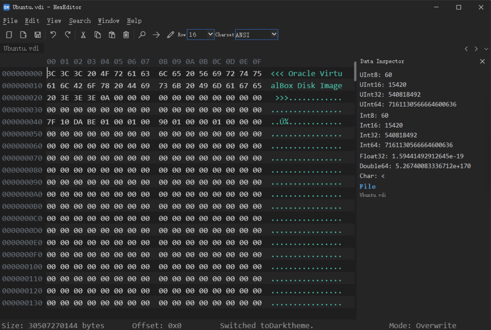
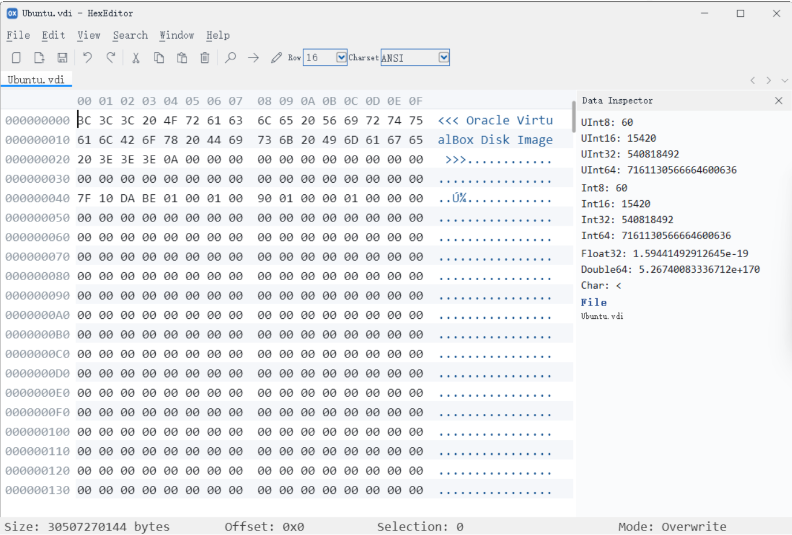

# HexEditor — 基于 SOUI4 的跨平台十六进制编辑器

一个用 [SOUI4](https://gitee.com/setoutsoft/soui4)（跨平台 C++ DirectUI 框架）实现的 HxD 风格十六进制编辑器。
界面与渲染全部走 SOUI 控件树，逻辑层（文件模型、检索、撤销栈）不依赖任何平台 API，
因此在 Windows / Linux / macOS 上共用同一份代码。

当前已在 Windows 11 x64 (MSVC 2022) 与 Ubuntu 24.04 上完成构建与运行验证；macOS（arm64）
已通过本仓库的 GitHub Actions 工作流验证编译与启动（尚无真机交互实测）；其他平台使用 `swinx` 适配层，
源码已按跨平台组织。

## 截图

图中打开的是一个 30.5 GB 的 VirtualBox 磁盘镜像（`Ubuntu.vdi`）：内存映射 I/O 让任意大小的文件都是毫秒级打开，右侧数据检查器实时解码光标处的值。

| 深色主题 | 浅色主题 |
| --- | --- |
|  |  |

---

## 1. 功能

| 分类 | 能力 |
| --- | --- |
| 文件 | 打开任意大小文件（**毫秒级**）、保存、另存为、命令行直接传路径 |
| 显示 | 偏移列 / 十六进制列 / ASCII 列三栏布局，斑马纹底色，16 字节对齐 |
| 选择 | 鼠标拖选、双击选中连续可打印串、Ctrl+A 全选、Shift+方向键扩展 |
| 编辑 | 十六进制 nibble 输入、ASCII 直输、插入/覆盖双模式、Backspace/Delete |
| 剪贴板 | Ctrl+C/V/X（同时提供二进制与 Unicode 文本两种剪贴板格式） |
| 撤销 | Ctrl+Z / Ctrl+Y，多级撤销栈，含插入/删除/覆盖三类操作 |
| 检索 | Boyer–Moore–Horspool、后台线程 + 进度、文本/十六进制两种模式、上一个/下一个 |
| 定位 | Ctrl+G 转到偏移（支持 `0x` 十六进制）、F3 查找下一个 |
| 检查器 | 右侧实时显示 8/16/32/64 位无符号、同宽有符号、Float32/64、字符 |
| 状态栏 | 文件大小、光标偏移、选择长度、当前编辑模式 |
| 配色 | 浅色 / 深色主题（查看菜单切换，写入 `HexEditor.ini` 记忆），覆盖十六进制区、标题栏、菜单栏、工具栏、标签栏、状态栏和数据检查器，**包括主菜单和标签栏 ▾ 的下拉弹层**（都改成了 SOUI 自绘的 `SMenuEx`） |

快捷键：

```
Ctrl+O 打开        Ctrl+S 保存       Ctrl+F 查找        Ctrl+G 转到
Ctrl+Z 撤销        Ctrl+Y 重做      F3      查找下一个
Ctrl+A 全选        Ctrl+C/V/X 复制/粘贴/剪切
Tab    切换十六进制/ASCII 输入列     Esc 取消选择
Home/End 行首/行尾（Ctrl 为文件首/尾）   PageUp/PageDown 翻页
```

---

## 2. 为什么能「秒开」大文件

```
打开文件 ──> CreateFileMapping + MapViewOfFile（Windows）
          └─> open + mmap（POSIX）
```

一次映射，不读内容；页面由操作系统按需换入，因此打开 40 GB 的文件与打开 1 KB 的文件耗时几乎相同，
也不会出现「把一个 40 GB 文件读进内存」导致的崩溃。

写操作完全不碰这块只读映射（这样做的好处是：编辑时其他进程仍能只读访问该文件）：

* **页覆盖层（copy-on-write）**：4 KB 粒度，只保存被改过的页，随机改写开销恒定；
* **Piece 表**：逻辑流 = 一串 Piece（基流存活区间 / 插入内容）。插入 = 插入一个 Piece，
  删除 = 丢弃被覆盖的 Piece，因此中间插入/删除不需要搬移后续几十 GB 数据；
  覆盖写完全不改变 Piece 结构，只写页覆盖层或插入缓冲；
* **插入缓冲**：插入内容顺序追加到 `std::vector`，相邻且连续的 Piece 自动合并，抑制碎片；
* **编辑日志**：撤销栈记录 OVR/INS/DEL 三类操作，支持多级撤销/重做（上限 200 组）；
* **保存**：以 1 MB 块流式写到同目录临时文件 → 关闭映射 → 原子替换 → 重新 `mmap`。
  （Windows 不允许覆盖仍有映射的文件，必须走临时文件替换，否则报 `ERROR_USER_MAPPED_FILE`。）

检索同样不分配大块内存：1 MB 滑动窗口 + 与窗口重叠 `len(pattern)-1` 个字节，
保证跨窗口命中；Boyer–Moore–Horspool 坏字符跳转让扫描次数远小于文件尺寸。

---

## 3. 目录结构

```
HexEditor/
├── CMakeLists.txt          构建入口（add_subdirectory(soui4) + 本工程目标）
├── README.md
├── patches/                锁定版本 SOUI/swinx 的本地补丁（构建必需，见第 4 节）
├── soui4/                  SOUI4 源码（gitee.com/setoutsoft/soui4）
├── src/
│   ├── HexFileModel.h/.cpp mmap + 页覆盖层 + 稀疏编辑段 + 撤销栈 + 保存
│   ├── HexSearch.h/.cpp    Boyer–Moore–Horspool 后台检索
│   ├── HexView.h/.cpp      SOUI 自定义控件：三栏绘制、鼠标/键盘、滚动、编辑
│   ├── MainFrame.h/.cpp    主窗口：工具栏、查找栏、状态栏、数据检查器、文件对话框
│   ├── main.cpp            SOUI 应用初始化与入口
│   └── resource.h
└── uires/
    ├── uires.idx           资源索引
    ├── uidef/init.xml      字体/颜色/样式定义
    ├── layout/main.xml     主窗口布局
    └── values/*.xml        字符串/颜色/皮肤
```

---

## 4. 构建

需要：CMake ≥ 3.16、Visual Studio 2022（或任意 MSVC v142）、Windows 10 SDK。

```bash
# 1) 获取 SOUI4（如果 soui4/ 目录不存在）
git clone --depth 1 https://gitee.com/setoutsoft/soui4.git soui4

# 2) 配置（在「x64 Native Tools Command Prompt for VS 2022」中执行）
cmake -S . -B build -G "Visual Studio 17 2022" -A x64

# 3) 编译
cmake --build build --config Release
```

**SOUI 版本锁定 + 必需补丁（重要）**：本工程的构建验证基于 SOUI 提交 `8a96e0745cdb7a01cecb8e26e00321b5f3a48c46`（2026-10-18），
其 `swinx` 子模块为 `992753b954222d3153aee12ec3b18ee0580c37b6`，**外加本仓库 `patches/` 目录里的补丁文件**。
该 SOUI 提交的原版代码在 Linux 上编不过：补丁修复了 SOUI 自身的两处宽窄字符编译错误
（`utilities/audio/SPlaySound_unix.cpp`、`components/render-gdi/linux/render-gdi.cpp`），以及若干 Linux 渲染问题
（菜单“标题\t快捷键”被画成方块、`SetMenuItemInfo` 丢弃 `MIIM_FTYPE`/`MIIM_STATE`、Skia 文本绘制性能等，每处修改均有注释）。
第三个补丁（`soui4-8a96e07-msvc-arm64-webp-neon.patch`）修复 Windows ARM64 下的链接失败：SOUI 内置的 stb 版 `webpdec.h`
只声明了 WebP 的 NEON DSP 初始化函数却从未定义，MSVC/ARM64 下 `imgdecoder-stb` 链接会报 LNK2019/LNK1120；
该补丁让 MSVC 下不启用 NEON、改走 C 回退实现。
更高版本的 SOUI 同样未经验证：截至 2026-11-16，SOUI 最新版（`9b32cec`）仍有同样的两处编译错误。
克隆 SOUI 后，请先切到锁定版本并打上补丁（在 HexEditor 根目录执行，该目录下 `soui4/` 与 `patches/` 并列）：

```bash
git -C soui4 checkout 8a96e0745cdb7a01cecb8e26e00321b5f3a48c46
git -C soui4 submodule update --init swinx
git -C soui4 apply ../patches/soui4-8a96e07-local.patch
git -C soui4 apply ../patches/soui4-8a96e07-msvc-arm64-webp-neon.patch
git -C soui4/swinx apply ../../patches/swinx-992753b-local.patch
```

也可以直接用 NMake 单配置生成器（等价，适合命令行/CI）：

```bash
cmake -S . -B build -G "NMake Makefiles" -DCMAKE_BUILD_TYPE=Release
cmake --build build
```

产物位于 `build/bin/`：`HexEditor.exe`、`soui4.dll`、`utilities4.dll`、`render-gdi.dll`、
`imgdecoder-stb.dll`、`soui-sys-resource.dll`，以及 `uires/` 资源目录。

运行：`build\bin\HexEditor.exe [文件路径]`

### 切换到 Skia 渲染

默认使用 GDI 渲染（依赖最少）。想用 Skia（文字抗锯齿更好）只需改 `src/main.cpp`：

```cpp
cfg.SetRender(Render_Skia)     // 原为 Render_Gdi
```

并确保 `render-skia.dll`、`skia` 相关库已被构建（CMake 已自动把它们列为依赖）。

### Linux 构建（Ubuntu 24.04，已实测）

```bash
sudo apt install build-essential ninja-build pkg-config libssl-dev \
  libxcb1-dev libxcb-render0-dev libgl1-mesa-dev libglu1-mesa-dev \
  freeglut3-dev uuid-dev libasound2-dev libfontconfig1-dev libfreetype-dev \
  libxkbcommon-dev libdbus-1-dev

cmake -S . -B build-linux -G Ninja -DCMAKE_BUILD_TYPE=Release
# 注意：这几个是 dlopen 加载的插件，不在链接依赖里，必须显式构建
ninja -C build-linux HexEditor resprovider-zip msftedit translator log4z
```

运行需要 X 会话；无 DISPLAY 时直接跑会段错误（139），CI 里用
`Xvfb :99 -screen 0 1280x800x24` + `DISPLAY=:99` 即可。

依赖两个系统字体，否则界面会有方块：`fonts-noto-cjk`（中文）、以及图标字体
**Segoe MDL2 Assets**（`C:\Windows\Fonts\segmdl2.ttf`，工具栏/标题栏/菜单勾选用的是它的码位）。
swinx 的 Linux 后端已实现 `AddFontResourceW`（走 fontconfig 的 `FcConfigAppFontAddFile`），
发布版可以把图标字体放进 `uires/font/` 并在启动时注册（注意该字体是微软授权，不可再分发，
正式发布建议换成开源图标字体或 SVG）。

#### 文件对话框（打开 / 另存为）

Windows 走 COM 的 `IFileDialog`；**Linux 走 swinx 的 `GetOpenFileNameW` / `GetSaveFileNameW`**，
它内部依次尝试 xdg-desktop-portal（DBus）→ KDE/GNOME 门户 → `zenity` 命令行。
所以 Linux 上必须装一个可用的文件选择器，否则菜单点了没反应：

```bash
sudo apt install zenity
```

（纯 Xvfb 环境里没有 DBus session，会直接落到 zenity 分支，实测可用。）
另外 swinx 会把 `OPENFILENAME.lpstrInitialDir` 原样当作 zenity 的 `--filename`，
所以这里传的是**当前文件的完整路径**，效果是定位到所在目录并把该文件预选上。

#### 跨平台适配踩过的坑（都是 Linux 上才暴露的）

| 现象 | 根因 | 处理 |
|---|---|---|
| 工具栏/标题栏图标全是空方块 | 缺 Segoe MDL2 Assets 字体，字形全 `.notdef` | 安装该字体（见上） |
| 检查器文件名只显示首字母 `s` | **glibc 的 `swprintf` 里 `%s` 是 `char*`，MSVC 才当 `wchar_t*`**，宽串被按窄字符解释、遇 `0x00` 截断 | 裸 `swprintf` 改用 `SStringT::Format` |
| 菜单项 `标题<方块>Ctrl+F`，快捷键不右对齐 | Skia 渲染器下 `\t`(U+0009) 没有字形 | `SMenuExItem::OnPaint` 里按 `\t` 拆成左右两段，右段 `DT_RIGHT` 绘制 |
| 深色主题下菜单勾选标记不显示 | `menu_check_dark.svg` 里的 `<circle>` 让整张图解码失败 | 圆环/圆点改成等效 `<path>` 弧线 |
| 检查器 `txt_file` 只显示 1 个字 | `multiLines` 文本在 vbox 里 wrap-content 宽度被算成 1 字 | 给固定 `size="280,20"`，并去掉 `multiLines` |
| 深色下检查器标题「数据检查器」隐形 | `ApplyTheme` 只 `Invalidate()` 了 content 子树，caption 区域没重绘 | `ApplyTheme` 末尾整窗 `Invalidate()` |
| 检查器 `Float32`/`Double64` 末位被裁 | DejaVu Sans Mono 比 Consolas 宽约 10% | 默认厚度 270 → 300 |
| 「文件→打开/另存为」点了没反应 | `PickFile()` 在非 Windows 分支是 `return FALSE` 的空桩 | 改用 `GetOpenFileNameW`/`GetSaveFileNameW`（见上，需 zenity） |
| 组合框 `16` 文本偏上 | `m_nFontHeight` 取自 `MeasureText("A")`，Skia 返回的是字形包围盒（`-fTop+fBottom`）而非行高；字体包围盒比编辑框还高时 `(客户区高-字体高)/2` 为负，richedit 视图被撑出客户区 | **不能改**：把字体高度换成 `tmHeight` 反而偏下 3.5px（richedit 是贴着视图顶边画的，`1px 留白 = 1px 位移`）。当前值恰是光学最优；根治要动 richedit41 的行定位 |

框架层（swinx，仅平台专属文件，Windows 无影响）另外补了两处：
`SetMenuItemInfo` 补上 `MIIM_FTYPE`/`MIIM_STATE`（否则 `MF_OWNERDRAW` 丢失，
菜单退回默认绘制）；菜单默认绘制分支与 cairo 的 `TextLayoutEx` 都加了 `\t` 处理。

### macOS 构建（arm64，已通过 GitHub Actions 验证）

macOS 由 `.github/workflows/macos-build.yml` 在每次推送时验证：拉取锁定版 SOUI + swinx、
打 `patches/` 补丁、用 clang/Ninja 编译，并做 10 秒启动冒烟测试。在 Mac 上本地复现：

```bash
brew install ninja pkgconf glfw glew openssl@3
# 把 SOUI 克隆到 soui4/，切到锁定版本并打上两个补丁（见上方版本锁定说明）
cmake -S . -B build-macos -G Ninja -DCMAKE_BUILD_TYPE=Release \
  -DCMAKE_OSX_ARCHITECTURES=arm64 \
  -DCMAKE_C_COMPILER=/usr/bin/clang -DCMAKE_CXX_COMPILER=/usr/bin/clang++ \
  -DPNG_HARDWARE_OPTIMIZATIONS=OFF \
  -DOPENSSL_ROOT_DIR="$(brew --prefix openssl@3)"
cmake --build build-macos --parallel
```

这次验证顺带修了两个可移植性问题：本工程需要 **C++17**（文件模型里 `std::shared_ptr<u8[]>`
的下标用法 — libc++ 在 C++11 模式下会拒绝，MSVC/libstdc++ 则是宽容放行）；字符串对象不能
直接传给可变参数函数（`SStringT::Format` 的实参要 `.c_str()`，clang 会报错，MSVC/GCC 只是靠对象布局碰巧能用）。

---

## 5. 设计要点

* **控件**：`CHexView` 继承 `SWindow`，通过 `DEF_SOBJECT(SWindow, L"hexview")` 注册，
  在 `main.cpp` 中 `app.RegisterWindowClass<CHexView>()`，XML 里即可写 `<hexview .../>`。
  绘制只依赖 `IRenderTarget`（绘制文本/矩形、字体选择），全部坐标都是客户区局部坐标，
  由 SOUI 负责双缓冲与窗口合成。
* **编辑模式**：覆盖模式改写当前字节；插入模式在光标处插入新字节（文件变长）。
* **数据流**：`HexFileModel` 完全不认识 UI，`CHexView` 不认识文件系统，
  二者通过 `IHexSource`（检索用）和直接接口调用交互，方便写单元测试。
* **跨平台**：文件操作、线程、剪贴板都按 `#ifdef _WIN32 / #else` 分成两套实现；
  UI 层与 SOUI 一起通过 `swinx` 保持同一套代码。
* **配色**：`src/Theme.h/.cpp` 定义 `STheme`（十六进制区 `SHexPalette` + 窗口外框 `SChrome`），
  浅色/深色各一套。`CMainFrame::ApplyTheme()` 负责下发：
  - 十六进制区用 `CHexView` 自己的 `colorBg/colorBgAlt/colorOffset/colorHex/colorAscii/
    colorSelBg/colorSelText/colorCaret/colorGrid` 属性；这些 `ATTR_COLOR` 都是
    `bInvalidate=FALSE`，改完必须手动 `Invalidate()`。
  - 外框用 `SetAttribute(L"colorBkgnd"/L"colorText"/...)` 改纯 window 的底色和文字色
    （底色由 `SWindow::OnEraseBkgnd` 填）；菜单项文字色来自 `<btnstyle>`、不继承父级，
    需遍历 menubar 子窗口逐个改。
  - 数据检查器是独立 `SHostWnd`，由 `CInspectorWnd::ApplyTheme()` 单独下发。
    值行是 `SEdit`（`SRichEdit` 不画自己的背景、是把父窗口背景 BitBlt 过来），
    所以只要给内容容器设 `colorBkgnd`、给值行设 `colorText` 即可。
  - 工具栏图标和窗口按钮用的是 `Segoe MDL2 Assets` 字形，改 `colorText` 就够，不需要换皮肤。
  - **工具栏两个下拉框**（每行 / 字符集）要分四处处理：组合框自身 `colorBkgnd`、
    内部 `edit` 子窗口的 `colorText`（子窗口不继承父级）、下拉箭头 `btnSkin`
    （深色用 `svg/dropbtn_dark.svg` 注册的 `skin_dropbtn_dark`）、
    以及下拉列表 `SComboBox::GetListBox()` 的 `colorBkgnd`/`colorText`。
  - **标签栏**：`tabctrl_ex` 的 `tabSkin` 在深色下换成 `colorrect` 皮肤 `skin_tab_dark`
    （选中态走 `PushDown`——`STabCtrl::OnPaint` 对当前页用 `WndState_PushDown`）；
    右侧三个滚动/列表按钮原本没有 `skin`、吃的是系统默认按钮皮肤（浅色底），
    改成 `skin="skin_tb_btn"`（透明扁平）后 `colorBkgnd`/`colorText` 才生效。
  - **弹出菜单**：主菜单和标签栏 ▾ 的列表都改成了 SOUI 自绘的 `SMenuEx`，跟随配色。
    - `main.xml` 的 `menubar` 开 `useMenuEx="1"`；`uires/smenu/*.xml` 全部改成
      **`menuRoot` 根节点 + `menuItem` 子项**（`SMenu` 原生解析认 `<menu>`/`<item>`，
      `SMenuEx` 只认 `menuRoot`/`menuItem`，标签不对菜单就是空的）。
    - 标签列表的模板是 `uires/smenu/menu_tablist.xml`（空 `menuRoot`），
      条目运行时 `AppendMenu` 加。
    - 深色皮肤：`skin_menu_dark`（条目底，选中 `#094771`）/ `skin_menu_sep_dark` /
      `skin_menu_check_dark` / `skin_menu_arrow_dark`。
  - **`SMenuEx` 的两个硬约束**（都踩过）：
    1. 标签名必须是 `menuRoot` / `menuItem`，否则菜单为空、点开没东西；
    2. **皮肤必须在条目创建之前定好**——`SMenuExItem` 构造时就把 root 的
       `m_pItemSkin` 拷了一份（`SMenuEx.cpp:537`），之后再改 root 属性对已建条目无效
       （现象：文字色变了、底色还是浅色）。
       所以切主题时要**重建菜单**：`DestroyMenu()` → 把主题属性注入 XML 根节点
       → `LoadMenu2()`。这段逻辑在 `CMainFrame::ApplyChromeTheme()` 里，
       `kMenuRes[]` 的顺序必须和 `main.xml` 里 `<menus>` 的声明顺序一致。
> **菜单皮肤只在启动时重建一次，运行中切主题不再动菜单。**
> 原因：`SMenuBar::PopMenu()` 里 `m_pHostMenu->m_pNowMenu` 是「正在弹菜单」的状态位，
> 菜单会话期间若把 SMenuEx 窗口销毁/重建（`DestroyMenu()+LoadMenu2()`），
> 会把 `PopMenu` 的状态搞坏 —— 之后每次点击都会在入口
> `if (m_pNowMenu != NULL) return 0;` 直接返回，**菜单再也弹不出来，只能重启**。
> 所以 `RebuildMenuSkins()` 只在 `OnInitDialog` 里调一次（那时菜单窗口还没显示过，安全）。
> 代价：运行中切换主题后，下拉菜单的配色要**下次启动**才跟着变；
> 标题栏/菜单栏/工具栏/标签栏/状态栏/编辑区/检查器都是即时切换的。
  - 原生菜单的暗色开关也接了但**实测无效**（保留着，换机器可能有用）：
    uxtheme 的 `SetPreferredAppMode`(135) / `FlushMenuThemes`(136) /
    `AllowDarkModeForWindow`(133)，见 `Theme::ApplyNativeMenuTheme()`、
    `Theme::AllowDarkWindow()`，并补了 `src/app.manifest` 的 `supportedOS` 声明，
    经 `HexEditor.rc` 的 `1 24 "app.manifest"` 嵌入（类型必须写数字 24）。
* **新增 .cpp 记得重新 configure**：`CMakeLists.txt` 里 `file(GLOB ... CONFIGURE_DEPENDS)`
  已开启自动重新 configure，否则新文件不进构建（表现为 `LNK2019 无法解析的外部符号`）。
* **改了头文件必须全量重编本工程源码**（`CMakeLists.txt` 已用 `OBJECT_DEPENDS` 强制）。
  踩过的坑：给 `CHexView` 加成员后，只有 `HexView.cpp` 被重编，`main.cpp`/`MainFrame.cpp`
  仍用旧的 `sizeof(CHexView)` 去 `new`，构造函数按新布局写成员 → **越界写堆**，
  表现为随机 `0xC0000374`（时好时坏，加两行日志就能"消失"，极易误判为浮层绘制代码有 bug）。

### 浮层滚动条（Win11 风格）

`CHexView` 的滚动条**不用 SOUI 的布局内嵌滚动条**，改为在内容之上自绘浮层：

* `main.xml` 里 `<hexview sbWid="0" sbArrowSize="0"/>` —— SPanel 不再为滚动条预留布局空间、
  也不自绘（`sbWid` 必须为 0，任何非 0 值都会留出永久空白槽位）。
* 静止态：6px 细条，圆角胶囊滑块（`FillSolidRoundRect`，颜色由 `m_crBg` 亮度自动取深/浅）；
  悬停态：加宽到 14px，画出轨道 + 两端三角箭头。**全程不改变布局，内容不重排**。
* **滑块的行程要扣掉两端箭头**：轨道两端各 14px 是箭头按钮的位置，滑块只能在
  `SbThumbTrack()`（= 轨道内缩一个箭头宽度）里移动，否则拖到顶端会把上箭头盖住。
  **静止态虽然不画箭头也要同样内缩**——否则悬停时箭头一出现，滑块会被挤下去 14px，
  看起来像"跳了一下"。`SbThumb()` 和 `SbUpdateDrag()` 必须用同一个区间，
  否则"显示位置"和"拖动换算"会不一致。
* 横竖两个方向都支持（`SbNeedV()`/`SbNeedH()` 走 `HasScrollBar()`，滚动位置取
  `GetScrollBarInfo()` 的 `nMax/nPage/nPos`，与滚轮/键盘滚动天然一致）。
* 交互：`SbHandleDown()` 命中滑块则开始拖动、否则整页翻动；`SbUpdateDrag()` 换算位置后
  `SetScrollPos()`；`OnMouseMove` 里先更新悬停态再走原有的内容命中逻辑。
* **光标**：`OnSetCursor()` 里滚动条区域、以及**拖动滚动条期间**一律返回箭头。
  拖动时指针很容易滑到 hex/ascii 内容上，若不特判就会切成 I-beam，很别扭。
  另外 `OnMouseMove` 对拖动做了兜底：若 `nFlags` 里没有 `MK_LBUTTON`（在窗口外松开时
  收不到 `WM_LBUTTONUP`）就立即结束拖动，否则会残留"光标一直是箭头、指针一动就继续滚"。
* 两个坑：
  1. **鼠标消息给的是 host 客户区坐标**，必须 `ToLocalPoint()` 转本地坐标再做命中测试；
  2. `FillSolidRect`/`FillSolidRoundRect` 走 `SColor(cr)`，**高位字节是 alpha**，
     传 GDI 的 `RGB()`（高字节 0）会画成全透明。本工程主题色来自 XML（ARGB），安全。
* **箭头方向**：`SbDrawArrow(pRT, rcCell, bVert, bToStart, cr)` 的 `bToStart` 表示
  「尖端朝起点侧」——竖直方向的起点是**上**、水平方向的起点是**左**。所以
  顶端/左端箭头传 `true`（上三角 / 左三角），底端/右端传 `false`（下三角 / 右三角）。
  这一组参数一开始传反了（上下、左右都反），已修正。
* 两个调试开关（仅用于自动化验证，正常运行不需要）：
  `HEX_FORCE_HOVER=1` 锁定悬停态（本机前台常被别的进程占住，真实光标进不到窗口，
  系统会立刻补发 `WM_MOUSELEAVE`）；`HEX_OV_OFF=1` 完全关闭浮层。
  `tools/probe_overlay.py` 用 `PrintWindow(PW_RENDERFULLCONTENT)` + 直接投递鼠标消息做截图验证。

---

## 6. 已知限制 / 后续工作

* 非 Windows 平台：Ubuntu 24.04 已实测可编译运行：菜单/工具栏/查找替换/关于/数据检查器/
  深色浅色主题/中英文切换/右键菜单均已验证；Linux 文件对话框走 swinx 的 `GetOpenFileNameW` /
  `GetSaveFileNameW`（xdg-desktop-portal 或 zenity，见第 4 节），剪贴板在非 Windows 下仍退回进程内缓冲区。
  macOS（arm64）已通过 GitHub Actions 验证编译与启动（10 秒冒烟运行），尚无真机交互实测。
* 32 位进程无法整体映射 >2 GB 文件（Windows 的 `MapViewOfFile` 地址空间限制），
  需要改成「分段映射窗口」；64 位目标不受影响。
* 暂无字符集切换（ASCII 视图固定按 Latin-1 可打印判定）、无差异高亮、无书签。
* ASCII 列暂未处理 GBK 等多字节双字节字符占位（仅按 Latin-1）。
* 拖选未使用 `SetCapture`：SOUI 的控件级鼠标捕获在释放时机上不可靠，漏放会吞掉后续点击
  （工具栏按钮点不动）。当前拖选依赖鼠标移动消息 + 边缘自动滚动，指针移出控件时会暂停。
* 工具栏右对齐的「撤销/重做/覆盖」在窄窗口下可能被挤出可视区，属于布局待优化项。

## 7. 测试

* `hexeditor-test`（不依赖 UI）：400 轮随机「覆盖写/插入/删除/截断」与 `std::vector`
  参照模型逐字节对照；120 组操作的逐步撤销/重做校验；保存/重开一致性；
  512 MB 文件 mmap 秒开与中部插入。全部通过。
* `tools/gui_smoke.py`：真实窗口端到端——点击十六进制单元格 → 输入十六进制字符 → 点保存，
  校验文件恰好一个字节被修改。
